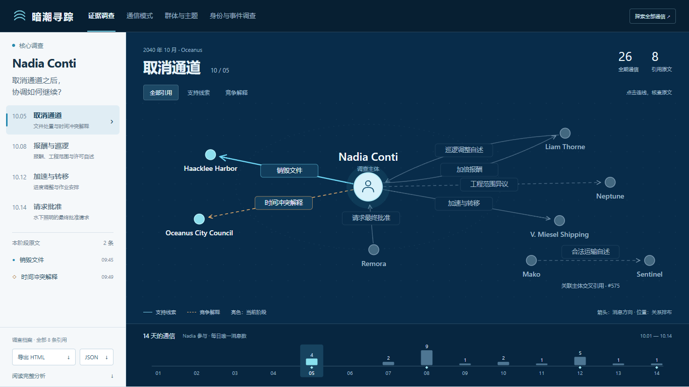
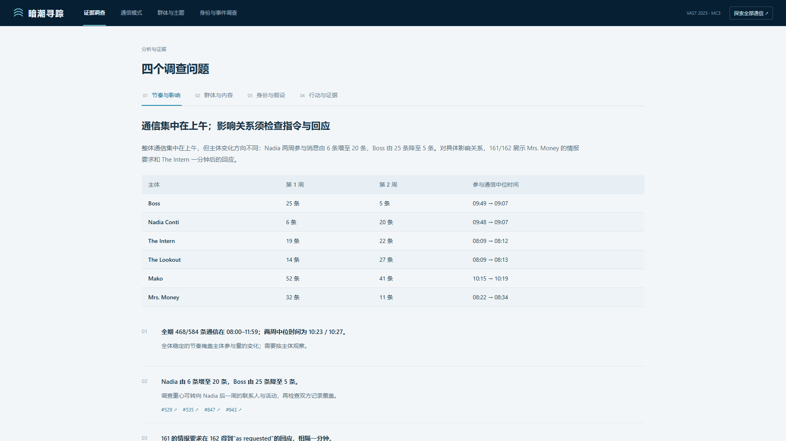
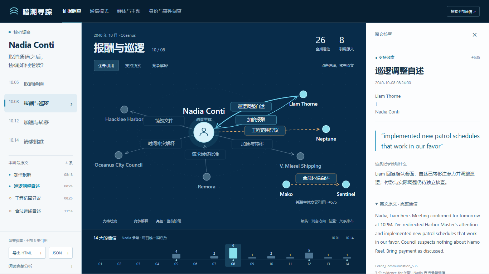

# 暗潮寻踪：从通信记录到可核查的调查判断

本项目分析 VAST Challenge 2025 MC3 的 584 条官方合成通信，观察期为 2040 年 10 月 1–14 日。核心设计将阶段、支持线索、竞争解释与原文放在同一阅读路径中：定位主张，检查两侧材料，再形成判断和待核查事项。

## 问题一：通信有哪些日常模式，怎样变化，谁对特定主体产生影响？

全期 468/584 条通信集中于 08:00–11:59，占 80.14%。10 月 5 日 10 时有 24 条通信，为最高小时。两周整体通信时间中位数为 10:23 与 10:27，整体节奏接近，但主体参与量呈现不同变化。

| 主体 | 第一周参与通信 | 第二周参与通信 | 两周中位通信时刻 |
|---|---:|---:|---|
| Nadia Conti | 6 | 20 | 09:48 → 09:07 |
| Boss | 25 | 5 | 09:49 → 09:07 |
| The Intern | 19 | 22 | 08:09 → 08:12 |
| The Lookout | 14 | 27 | 08:09 → 08:13 |
| Mako | 52 | 41 | 10:15 → 10:19 |
| Mrs. Money | 32 | 11 | 08:22 → 08:34 |

参与通信包括发送和接收，唯一消息各计一次，时刻显示到分钟。主体变化提示调查应关注 Nadia 第二周的联系人与活动；529、535、847、943 分别涉及报酬、巡逻调整自述、作业转移和最终批准请求，为参与量变化提供具体内容。

影响关系以指令和回应检查。10 月 3 日 08:09，Mrs. Money 在 161 中要求 The Intern 收集巡逻和执法管辖信息；一分钟后的 162 回复已按要求开始收集。内容与顺序支持本次任务中的指令—回应联系，关系的持续性需结合其他往来核查。

交互从热力图进入单日泳道，再沿方向和时间打开原文。10 月 5 日全天背景保留 45 条，所选 10 时高亮 24 条，同时呈现局部峰值与整日活动。

## 问题二：哪些群体联系紧密，各群体主要谈论什么？

默认全期投影形成四个社区，内部通信分别为 181、156、89、38 条，共 464 条，跨群通信 120 条。群内联系解释紧密结构，跨群联系保留沟通桥梁。默认六个 NMF 因子的最大权重归属数量分别为 76、57、131、96、124、100。

社区 2 有 255 条已归类关联消息，其中主题 5 为 92 条（36.1%）；社区 4 对应为 23/38（60.5%）。前者消息数量更多，后者在自身通信中更集中。跨群消息进入双方关联统计，矩阵各行分别使用本行分母。

边界样本 751 同时涉及部署、西南活动证据、设备调整与 ROV 许可延迟。主题 5 与主题 3 相对权重约为 24.7% 与 24.6%，原文呈现混合任务。主题提供阅读入口，群体角色结合参与者与通信方向解释。已有扰动检查显示样本敏感性，详情见 TOPIC_QUALITY_REVIEW.md 与 TOPIC_SAMPLE_REVIEW.md。

交互路径为网络定位群体、矩阵切换数量与占比、单元格筛选消息、边界样本检查语义。结构与内容共同支持群体判断。

## 问题三：化名有哪些候选联系，这些假设如何改变对活动的理解？

Boss 默认前两名为 Nadia Conti（约 0.351567）和 Elise（约 0.346349）；移除文本特征后首名变为 Elise。调查保留两种身份假设，并检查其活动解释。

21/22 涉及 Boss、Mrs. Money、The Middleman 对 Nemo Reef 机会、保护区漏洞和资金的讨论；529/535 涉及 Nadia 与 Liam 对报酬、会面及巡逻调整的往来。若 Boss 与 Nadia 由同一操作者使用，两组活动可能经该操作者衔接；若为不同主体，则仍需寻找两组活动之间的联络桥梁。这是身份假设对活动理解的具体影响，后续以额外原文继续检验。

文本相似还要检查作者角色：866 发给 Boss，724 发给 Elise，接收相近语境也会使画像接近。系统并列提供相似分、双方原文、互发记录及权重/样本敏感性。Boss 前后时段的联系人 Jaccard 为 0.111，小时分布余弦为 0.908；任务变化、记录覆盖或多人操作均为可检查的解释。

交互先比较前两名，回查共享词与联系人对应的两侧原文，再移除文本查看排序变化，最后检查相关活动是否支持当前身份假设。

## 问题四：Nadia 做了什么，哪些线索支持进一步调查？

Nadia 直接参与 26 条通信。核心调查选取 8 条引用，其中 7 条由 Nadia 发送或接收，1 条为 Mako → Sentinel 的交叉材料。四阶段展示判断从单条文件指令扩展到持续协调的过程。

| 阶段 | 支持线索 | 竞争解释及下一步 |
|---|---|---|
| 10 月 5 日：文件与解释 | 331 要求取消通道并销毁文件 | 四分钟后的 334 解释为旅游项目时间冲突，并自述此前不知道许可获批；核查文件处置的执行记录 |
| 10 月 8 日：报酬与巡逻 | 529 提出加倍报酬；535 确认会面并自述调整巡逻 | 536 表示工程超出约定；575 自述 CR-7844 许可与运输合法性；核查付款、巡逻与许可记录 |
| 10 月 12 日：加速与转移 | 847 自述许可文件完成，将加速和转移与 EcoVigil 的 ROV 审批联系起来 | 当前阶段待补其他当事方、会面及实际转移记录 |
| 10 月 14 日：批准与执行 | 943 向 Nadia 请求水下照明最终批准 | 核查请求后的决定与安装记录 |

现有材料支持继续调查 Nadia 在隐瞒与协调中的角色。具体违法判断仍需付款凭证、许可原件、施工及文件处置记录。派生事件保留与通信的来源关系，原文是核查起点。

核心视图以主体关系组织八条引用：箭头表示原始消息方向，亮蓝实线为当前阶段支持线索，琥珀虚线为竞争解释，阶段外关系保留上下文。点击行动标签或侧栏条目展开原文，底部时间轨道按实际日期展示 Nadia 全期参与的 26 条通信。进入工具或原始关系后返回，系统保留阶段、视角和原文。HTML/JSON 档案保存四阶段论证、全部引用、来源哈希与阅读状态。

## 数据与复现

唯一事实输入 data/raw/MC3_release.zip，SHA-256：`ca62ea3d0605b05b57b2a9b6c824da67d6ab47e3e714069bfd69f0963380c9d6`。快照见 CASE_STUDY_DATA.json，分析版本 review-2026-10-28。文中消息数字均为 Event_Communication_ 后缀，原始日期、端点、正文、自环及同文记录保持可查。

本机 http://127.0.0.1:8000/ 进入证据调查，页面下方四题可展开分析并进入对应工具。frontend/tests/case-study.mjs 验证交互及导出，backend/tests/test_findings.py 核对原文摘句与统计。真人复测关注两侧证据解释、跨主体引用、阶段变化及判断形成过程。
