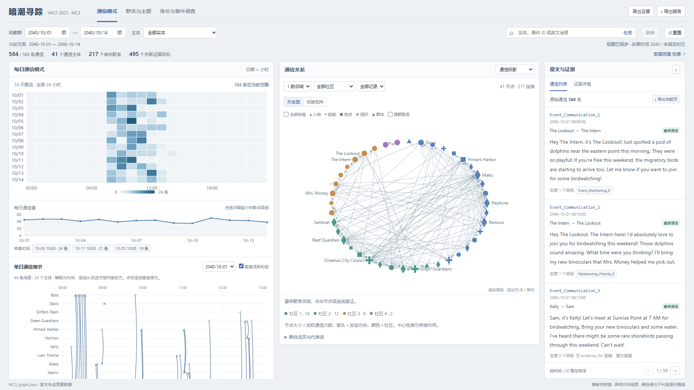
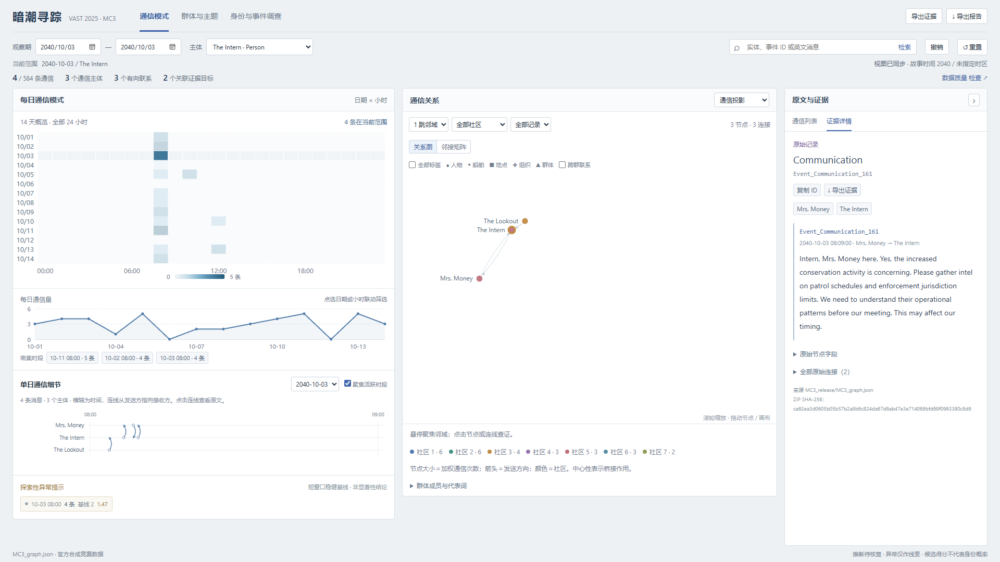
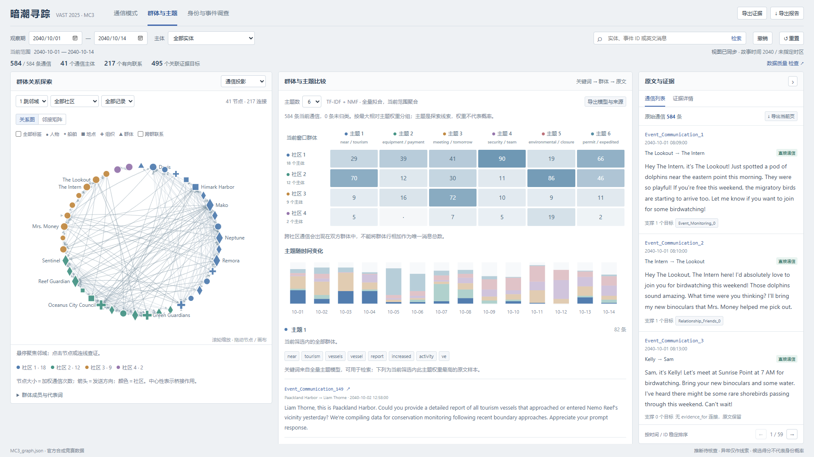
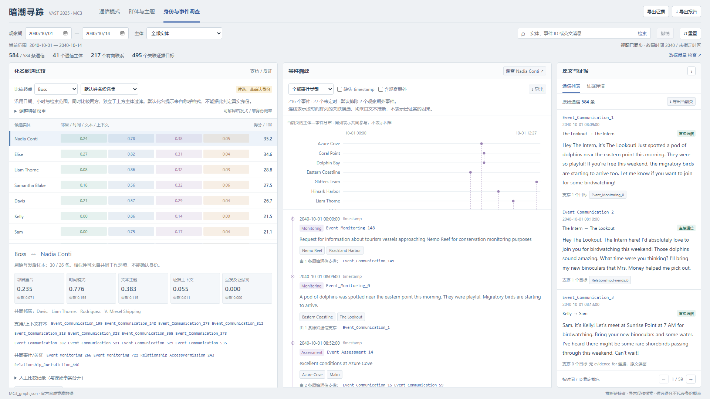
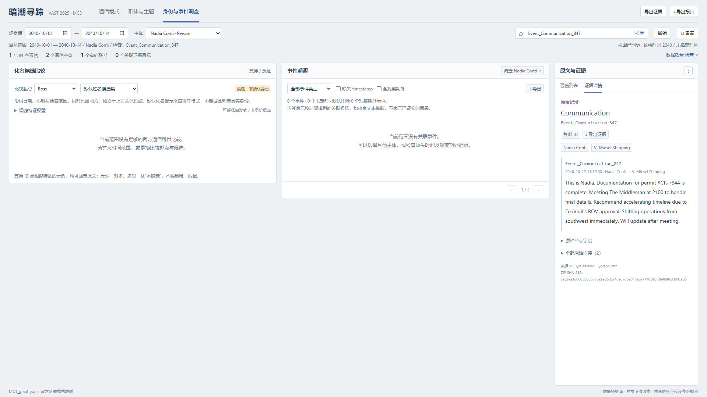

# MC3 四题分析底稿

> 本文与配套 JSON 是第二阶段 nmf-v2 分析快照。后续工程已补齐船舶同类候选、人员—船舶角色、前后时段画像、来源检查及全范围事件概览；文中涉及“尚未支持”的实现描述仅指该快照。当前 nmf-v3 主题计数与四题说明见 [CURRENT_ANALYSIS.md](CURRENT_ANALYSIS.md)，当前实现与质量判断见 [最终项目验收](FINAL_PROJECT_AUDIT.md)。原分析结论、引用及当时源码哈希保持不变。

日期：2026-10-22，Asia/Shanghai。阶段：第二阶段。本文形成可审阅的分析答案和证据入口，尚不是最终课程答卷；没有据此确认身份或判定具体罪名，也没有把图形质量和课程交付标记为完成。

## 来源、口径与判断层级

唯一事实输入是 [官方 MC3 压缩包](../data/raw/MC3_release.zip)，SHA-256 为 `ca62ea3d0605b05b57b2a9b6c824da67d6ab47e3e714069bfd69f0963380c9d6`。包内答题表给出四组问题；数据说明明确事件和关系由故事人物从通信中推断，可能有错误或矛盾，且只能使用本题数据。

[配套证据包](MC3_ANALYSIS_EVIDENCE.json) 保存统计口径、消息集合、当前模型参数、候选特征、敏感性结果、584 条原文快照及选定原始证据边。原始 ZIP 和应用代码均未改动。

本文区分三层：

- **记录层**：图中有某条通信及其原文、时间和端点；这不等于原文描述的物理行动已经发生。
- **推断层**：官方 Event/Relationship 和本项目算法结果；它们有来源，但不是新增的独立观察。
- **分析层**：作者结合记录作出的解释，必须保留竞争解释和未解问题。

故事时间为 2040 年，不转换现实 UTC。通信统计以官方 584 个 Communication 节点为单位，不擅自去重或修正端点。涉及方向的实质判断优先选择原文称呼与图端点一致的消息。

## Q1：每日通信规律、两周变化与影响关系

### Q1a：记录集中于上午，消息时间与计划行动时间应分开

**可支持的回答：** 584 条记录的日内时间介于 08:03–14:03，其中 468 条（80.14%）发生在 08:00–11:59，10 时段为全期最密集小时。这个规律描述已提供记录的分布，不能据此断言夜间没有活动。

| 小时 | 08 | 09 | 10 | 11 | 12 | 13 | 14 |
|---|---:|---:|---:|---:|---:|---:|---:|
| 通信数 | 117 | 113 | 147 | 91 | 85 | 29 | 2 |

日内规律不是每天固定在同一个小时达到峰值：10-05 的 10 时有 24 条，为全期最高小时；10-02 的峰值为 12 时 18 条；10-08 为 11 时 18 条；10-13 为 12 时 19 条。10-07 的 10 时与 11 时同为 14 条，不能强行指定唯一峰值。

原文经常安排清晨、夜间行动，但发送时间仍在白天。例如 Event_Communication_504 于 10-07 11:15 安排次日 0500 的付款与 0600 的运输；Event_Communication_847 于 10-12 11:19 提到 2100 会面。因此应在图上区分“通信发生时间”和“原文提及的计划时间”，不能把计划时间当成已执行事件时间。

建议的图分析方法：以实体为节点、通信为带时间和方向的边，先按日/小时看密度，再展开单日主体泳道，沿发送—回应关系回查原文。概览负责比较，通信方向与内容负责解释。



### Q1b：局部峰值在变化，整体中位时间没有明显后移

| 指标 | 10-01 至 10-07 | 10-08 至 10-14 |
|---|---:|---:|
| 通信数 | 301 | 283 |
| 10 时段通信 | 85（28.24%） | 62（21.91%） |
| 11 时段通信 | 40（13.29%） | 51（18.02%） |
| 13 时段通信 | 22（7.31%） | 7（2.47%） |
| 日内时间中位数 | 10:23 | 10:27 |

**判断：** 后一周的 10 时集中度下降、11 时占比增加，但中位数只相差 4 分钟；数据支持局部时段构成改变，不支持“整体作息显著推迟”。未作统计显著性检验，14 天也不足以推断长期规律。

### Q1c：Mrs. Money 对 The Intern 的任务安排有直接内容证据

两者共有 20 条图上直接通信：The Intern→Mrs. Money 15 条，反向 5 条。数量不对称本身不能证明权力关系；以下请求—回应序列提供更具体的依据。

| 时间及消息 | 内容核对 | 能支持的判断 |
|---|---|---|
| 10-02 08:09/08:11，Event_Communication_90、Event_Communication_91 | Mrs. Money 要求整理保护区、迁徙和执法资料 | 明确的信息任务安排 |
| 10-03 08:09，Event_Communication_161 → 08:10，Event_Communication_162 | 要求调查巡逻安排和管辖范围；The Intern 回复已按要求开始 | 有时间顺序与内容对应的任务回应 |
| 10-05 10:47，Event_Communication_369 → 10:53，Event_Communication_372 | 要求调查许可批准者及航道交叠；回复调查信息 | 影响调查方向与汇报内容 |
| 10-11，Event_Communication_730；10-13，Event_Communication_864 | 要求照片与财务预测；后续回复已准备 | 持续的资料汇报关系，但不能确认资料内容或行动完成情况 |

辅助关系节点 Relationship_Operates_439 的角色为 Intern，来源是消息 730；它是同一通信的推断结果，不能算第二份独立证据。消息 Event_Communication_702 的图端点为 The Intern→The Intern，而原文自称 Mrs. Money，故不把它直接算作新增的 Mrs. Money 指令。

另一个可核对例子是 Event_Communication_846（V. Miesel Shipping→Nadia，10-12 11:17）催确认许可文件，Event_Communication_847（Nadia→V. Miesel Shipping，11:19）回复已完成，并建议调整时间表。它支持文件和进度协调，不能直接推导雇佣、控制或同一身份。



## Q2：哪些群体联系紧密，各自讨论什么

### 群体结构与跨群联系

全期通信投影有 41 个主体、217 个有向通信对、2 个弱连通分量。固定全期、seed=42 的 Louvain 得到 4 个群体。编号只表示这一模型的分组。

“内部”指发送与接收双方都在群体；“发出/接入”指跨群通信。各群体内部计数互斥，总计 464；另有跨群通信 120，合计 584。群体关联通信可同时计入跨群双方，不能将各群体关联总数相加当作通信总量。

| 群体 | 主体数 | 内部 | 跨群发出 | 跨群接入 | 内部占本群关联通信 |
|---|---:|---:|---:|---:|---:|
| 社区 1 | 18 | 181 | 47 | 56 | 63.7% |
| 社区 2 | 12 | 156 | 44 | 55 | 61.2% |
| 社区 3 | 9 | 89 | 29 | 9 | 70.1% |
| 社区 4 | 2 | 38 | 0 | 0 | 100.0% |

社区 4 只有 Clepper Jensen 和 Miranda Jordan，两者构成单独的通信分量。其原文讨论了其他主体，但“提到某人”与“直接向某人通信”是两种边，不能把未建立的通信边补进图里。

### 主题解释需要同时看内容与角色

以下主题描述是人工阅读后的概括，不是系统预置组织标签。模型采用既有固定语料 NMF 的 6 主题；下面只统计群体内部消息。当前页面的群体主题矩阵使用关联通信，口径不同，例如社区 1 的主题 4 页面为 90 条、内部为 77 条。

| 群体及代表成员 | 主要内容与模型提示 | 原文核对与竞争解释 |
|---|---|---|
| 社区 1：Mako、Remora、Neptune、Nadia、V. Miesel 等 | 内部 77/181 条归入安保主题，38 条许可，30 条设备/付款 | Event_Communication_460、Event_Communication_496、Event_Communication_504 涉运输与付款安排；Event_Communication_756、Event_Communication_812 涉安保与维持旅游外观。该组混有不同职责，不能整体标为“违法组织” |
| 社区 2：Green Guardians、保护船、Council、Liam 等 | 内部 66/156 条归入环境活动主题，39 条一般船舶活动主题 | Event_Communication_733 质疑封闭理由并寻求科学记录许可；Event_Communication_350、Event_Communication_351 展示快速审批要求。监督方与行政方同处一社区，反映往来，不代表立场一致 |
| 社区 3：Boss、Mrs. Money、The Intern、The Lookout 等 | 内部 64/89 条归入 meeting/tomorrow 等会议主题 | Event_Communication_11、Event_Communication_21、Event_Communication_22 讨论会面、财务和保护区漏洞；Event_Communication_91、Event_Communication_161 涉情报任务；也有普通观鸟内容。会议泛词不能替代更细的角色解释 |
| 社区 4：Clepper Jensen、Miranda Jordan | 内部 19/38 条归入环境活动主题 | Event_Communication_126、Event_Communication_469、Event_Communication_475、Event_Communication_774 是观察汇报及下一步调查。关键词与保护船相近，但角色是调查/汇报，不能只按主题合并 |

**回答：** 存在紧密通信群体，但“群体”并不等同于组织或一致立场。运输/许可/安保、监测/审批、会议/资金/信息工作、调查汇报形成不同内容组合；角色和跨群往来需要与主题一起解释。

### 边界主体不稳定

采用与生产代码相同的节点、边构建顺序，确认基线分组完全一致后，只移除 31 条自环并保留其余顺序，再运行 seed=42 Louvain。仍得到四组，规模变为 15、15、9、2；Glitters Team、Himark Harbor、Marlin、Serenity、Rodriguez 改变归属。按成员分区比较，调整兰德指数约 0.642。

这是一种数据处理扰动，不是稳定性证明。结果说明当前社区的边界对自环处理敏感；不能给这些主体贴上固定阵营。原始统计仍保留自环，本实验没有改写数据或替换页面模型。



## Q3：化名候选、共享使用与活动理解

### 已建立候选，尚未建立身份真值

Boss 和 The Lookout 是题目明确给出的化名示例。Mrs. Money、The Intern、The Accountant、The Middleman、Small Fry 只是称呼形式与通信内容支持的待调查起点，不应单凭名字确认它们都必然对应某个已命名人物。

下表使用现有默认权重、全观察期人物候选集。消息数是参与该称呼的官方通信节点数，得分为启发式关联程度。

| 比较起点 | 消息数 | 首名候选/100 | 次名候选/100 | 当前判断 |
|---|---:|---|---|---|
| Boss | 30 | Nadia Conti 35.16 | Elise 34.63 | 近似并列，不确认 |
| Mrs. Money | 43 | Elise 42.26 | Nadia Conti 37.35 | 有金融角色相似性，仍可能只是合作 |
| The Intern | 41 | Sam 47.44 | Elise 29.70 | 值得优先核查的候选，不是身份概率 |
| The Lookout | 41 | Kelly 32.83 | Nadia Conti 25.00 | Kelly 只有 3 条参与记录，证据稀疏 |
| The Accountant | 6 | Elise 29.26 | Liam Thorne 28.37 | 样本少且候选接近 |
| The Middleman | 20 | Elise 30.78 | Nadia Conti 27.79 | 缺少身份锚点，不以首名定案 |
| Small Fry | 7 | Rodriguez 37.68 | Samantha Blake 29.60 | 可能是技术/协调角色相似，仍需区分船舶操作者 |

### 两条值得继续调查的内容线索

**The Lookout ↔ Kelly：** Event_Communication_3、Event_Communication_443 中，Kelly 与 Sam 讨论 7 点观鸟、港口箱体和设备；Event_Communication_87、Event_Communication_441、Event_Communication_652 中，The Lookout 也对 Sam 提及观鸟与同一港口/保护区情境。二者共享联系人和生活安排，是支持候选的线索。但多个朋友可共享兴趣与地点，且 Kelly 只有 3 条消息、候选对没有共同 evidence_for 上下文，不能确认同一身份。

**The Intern ↔ Sam：** Event_Communication_369 要求 The Intern 调查许可，Event_Communication_370 中 Sam 同样向 Kelly 追问许可；Event_Communication_446 报告约 40% 航道交叠，Event_Communication_528 中 Elise 转述 Sam 得到这一信息；Event_Communication_596、Event_Communication_599 的水下结构观察，与 Event_Communication_601 中 Elise 对 Sam 的转述相呼应。这些内容支持相近的信息链，也完全可能是同伴之间传递消息，不能把重复转述算成独立身份佐证。

### 排名解释和共享化名边界

特征消融将邻居、时间、文本、上下文四项逐一置零，并对其余正项重新归一化，反证权重保持不变。此处只比较排名，不能跨模型比较分数大小：

- Boss：去掉文本特征后，Elise 首名约 36.12，Nadia 约 33.81；默认则 Nadia 首名。这是明确的特征依赖。
- The Intern→Sam 与 The Lookout→Kelly 在这组消融中保持首名，但后者样本仍只有 3 条；局部排名稳定不等于身份正确。
- Mrs. Money→Elise 也保持首名；去掉时间特征后，Elise 与 Davis 仅约 30.66 对 30.58，候选间隔对方法仍敏感。

目前每个称呼的全部消息被合并成一个画像，不能直接识别“多人共享同一化名”。若称呼跨时段呈现不同联系人和语境，既可能多人共享，也可能同一个人换任务。下一步应按时间/会话并列比较，保留多候选和冲突，不强迫唯一映射。本文尚未确认具体共享操作者。

### 船舶问题不能用“操作者关系”等同“身份”

Event_Communication_267、Event_Communication_268、Event_Communication_467、Event_Communication_574、Event_Communication_575 显示 Mako 的定位、转发器和许可说法受到质疑；其中许可编号从 NR-1045 转为 CR-7844，可能是更正、许可变更或说法矛盾，不能直接证明改名。

Relationship_Operates_58 连接 Davis 与 Mako，Relationship_Operates_75 连接 Rodriguez 与 Mako，后者角色为 captain；它们都是推断的操作关系，不是“Davis=Mako”或“Rodriguez=Mako”的身份等价。现有人物接口不支持船舶候选，本阶段也没有查出可确认的船名化名映射。

### 对活动理解的改变

若候选身份假设成立，原本分开的观鸟、资料收集与许可调查可能是同一人在不同称呼下的活动；Boss/Nadia 或 Mrs. Money/Elise 的假设也可能把资金安排、会议和作业转移连接起来。但这些只是待比较的情景。

即使不合并任何身份，原文已经显示运输、许可、资金、保护区信息和会面安排之间有联系。应先展示这些可回溯的信息流，再让用户检查身份假设会增加哪些边、产生哪些冲突。当前报告与系统都没有把上述情景写回原始图。



## Q4：Nadia 的行动和调查者的怀疑

### 可复核的行动摘要

26 条通信在原始图上以 Nadia 为一端；事件接口找到 15 个相关非通信事件，其中 2 个未定时。这个检索集合包括她的消息支持、但参与者不是她的事件，不能把它们都算作她亲自实施的行动。

| 阶段及消息 | 原文支持的主张 | 限定与替代解释 |
|---|---|---|
| 10-05：Event_Communication_330、Event_Communication_331、Event_Communication_333、Event_Communication_334 | 已讨论特殊通道；Nadia 明确要求取消并销毁相关文件；Council 随后追问，她解释为旅游项目时间冲突 | 销毁指令有直接内容依据；是否销毁、文件性质、解释是否属实未知。她当时自称不知道许可审批，不能直接认定其为谎言 |
| 10-08：Event_Communication_529、Event_Communication_535 | Nadia 提供双倍报酬以保持 Harbor Master 配合；Liam 回复转移其注意力并调整巡逻安排，且要求付款 | 支持规避调查的具体怀疑；没有付款凭证或独立巡逻记录，不能确认付款发生、手段或法律性质 |
| 10-08 至 10-10：Event_Communication_536、Event_Communication_537、Event_Communication_538、Event_Communication_601、Event_Communication_708 | 她追问超出约定范围的水下基础工程，随后确认讨论规格、成本及资金渠道；Elise 报告永久结构 | 不能倒推她最初就知道全部工程范围；Elise 对 Sam 的转述与派生事件不是独立的施工实测 |
| 10-11 至 10-12：Event_Communication_753、Event_Communication_795、Event_Communication_846、Event_Communication_847 | 保护船怀疑西南区域后，Nadia 指令转移作业/设备；向 V. Miesel 确认许可文件完成，并因 EcoVigil ROV 获批建议加速 | 结合上下文，支持主动应对监测和继续协调的解释；原文“proper channels”也可能是正常程序的自述，需核对实际许可 |
| 10-14：Event_Communication_943 | Remora 向她报告准备完成、维持旅游外观和监视保护船，并请求水下照明的最终批准 | 支持她处在授权请求链中；没有该条请求的明确回复，不能写成“已批准”或“灯光已安装” |

消息 Event_Communication_847 没有 evidence_for 边，仍有原始正文，不能因未生成事件节点而忽略这条关键通信。

### 对怀疑的分层回答

**有具体支持的部分：** Nadia 不只是被别人提到。她直接发出销毁文件、寻求有偿协调、转移作业和设备的指令，并向 V. Miesel 回复进度。在规避监测的语境下，这些记录使继续调查其隐瞒和协调行为具有具体依据。

**仍不能证明的部分：** 原文没有独立证实付款、施工、销毁或转移确已实施；许可有效性没有经认证的文件；部分指控来自相关方的转述。记录不足以确认其在本观察期继续非法捕鱼，也不足以把水下作业直接归为某项已证实违法行为。

**需要保留的反向材料：** Event_Communication_334 给出时间冲突的解释；Event_Communication_536 表示基础工程超出原约定；Event_Communication_575 是 Mako 对许可与合法运输的申辩。它们提供竞争解释，不能当作已核实的免责证明。Event_Communication_677 中 Sentinel 报告水质正常，削弱“水质问题导致封闭”的说法，但不能直接证明没有其他环境问题。

因此，调查者关于隐瞒和持续协调可疑作业的怀疑得到通信内容支持；关于具体违法行为、持续非法捕鱼及完整责任范围，仍应保留未证实结论。这里的“未证实”不等于“已经排除”。

### 必须绕开的角色和时间陷阱

- Event_Communication_521、Event_Communication_869 的图端点为 Davis→Nadia，但正文是向 Davis 发话的 Nadia 自称；Event_Communication_845 的图接收者为 Nadia，正文却明确对 V. Miesel 发话。保留原值，不据此额外推断谁指挥谁，也不自动改边。
- Event_Collaborate_868 的 10-14 09:00 来自消息 869 中对未来会面的安排，不能直接画成已举行会议。Event_Assessment_600 来自消息转述，不能当作第二次独立施工观察。
- Event_Monitoring_534、Event_Monitoring_752 等官方摘要可辅助检索，但它们和原文有信息压缩或方位措辞差异；关键判断须回到消息 535、753，而非只引用事件标题。



图中只有一条检索匹配，其他分析区为空是当前单条消息范围的结果，不表示 Nadia 没有相关事件。

## 贯穿四题的数据风险与验证

本轮发现 31 条图上自环，以及 4 组正文完全相同的双节点记录：Event_Communication_278 / Event_Communication_279、Event_Communication_804 / Event_Communication_805、Event_Communication_844 / Event_Communication_845、Event_Communication_866 / Event_Communication_867。584 个通信节点共有 580 种不同正文。相同正文也可能是转发或重复记录，不能未经证据就删除，更不能自动解释成同一身份。

原始端点、正文与推断关系均可能不一致。本文保留官方 584 的记录口径；对身份、影响和行为判断，不把这些表示重复当作独立佐证。后续测试应覆盖：同文异端点、自环、计划/实际时间、窗口外证据、角色冲突提示，以及群体内部/跨群口径。

证据包已校验：官方总数，小时/两周加和，内部与跨群加和，内部主题加和，584 条快照的原文/时间/端点，以及选定推断节点的 evidence_for 原边。所有正文判断仍需人工阅读，计数校验不证明语义判断正确。

### 社区敏感性复现方法

在项目根目录使用已有 Python 环境即可重算；不安装新依赖。必须复现原图构建顺序并先验证基线，避免把节点顺序变化和自环移除混在同一次实验中：

```python
from collections import Counter
import networkx as nx
from backend.app.data import dataset as d
from backend.app.graph import graph

u = nx.Graph()
for (a, b), count in sorted(Counter(
        (m['sender'], m['receiver']) for m in d.messages).items()):
    u.add_edge(a, b, weight=u.get_edge_data(a, b, {}).get('weight', 0) + count)
normalize = lambda groups: sorted([sorted(s) for s in groups],
                                  key=lambda s: (-len(s), s))
baseline = normalize(nx.community.louvain_communities(u, seed=42, weight='weight'))
assert baseline == [c['members'] for c in graph({})['communities']]
u.remove_edges_from(list(nx.selfloop_edges(u)))
print(normalize(nx.community.louvain_communities(u, seed=42, weight='weight')))
```

## 下一阶段的必要功能与完成边界

1. **人物/船舶比较边界。** 分开定义无线电称呼、船舶、操作者和人员候选；默认同类比较，跨类联系展示角色，不直接合并身份。先补能复现船舶接口拒绝的测试，再分批实施。
2. **影响与证据解释。** 将已核对的请求—回应、原文/图端点冲突、计划/观察时间区别带入交互；不新增无证据的因果箭头。
3. **群体与事件比较。** 明确内部/跨群口径、边界主体敏感性和两周事件概览；不通过重算后偷偷换社区身份。
4. **最终答卷与演示。** 把本底稿压缩为四题答案和 10–15 分钟汇报，完成可读图形、个人总结和包含当前源码的资料包。图形质量及船舶、共享化名问题仍未完成。

本阶段新增分析底稿与证据包，并更新评审进度，共 3 个文档/数据文件；截图是 work 下的过程材料。未改应用、依赖、原始数据、旧 FINDINGS 或旧验收结论，也未宣称课程项目封版。
